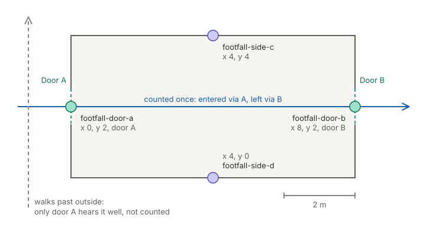
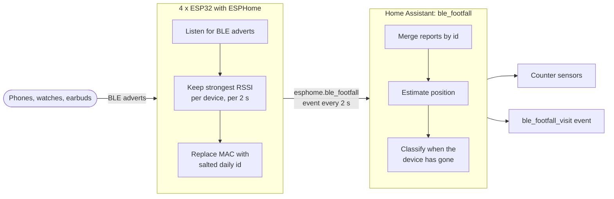
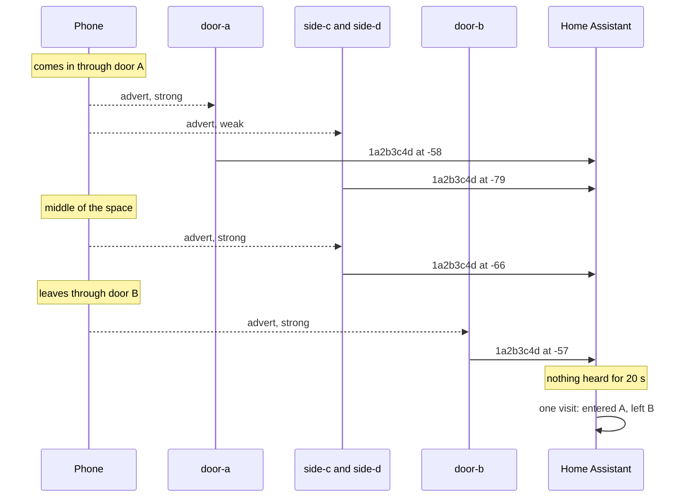
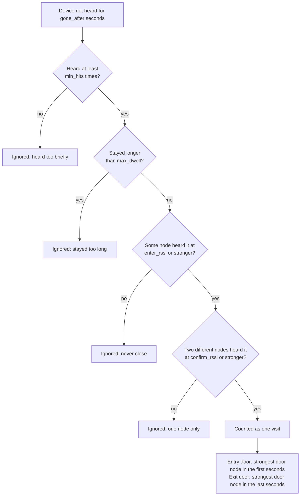

# BLE Footfall

Counts people walking through a space by listening for the Bluetooth signals their phones, watches and earbuds already send. Four ESP32 boards running ESPHome do the listening; a Home Assistant integration merges what they hear, estimates where each device is, and counts every device that comes in and leaves again as one visit, with the door it came in by and the door it left by.

Nobody is identified. The boards only report a scrambled id that changes every day, and Home Assistant never stores it.

> **Status:** the firmware compiles and the counting logic passes its tests, including a full run inside Home Assistant against a simulated radio. It has not yet run on real hardware, so the thresholds are starting values to tune on site (see [Tuning](#tuning)).

## Contents

- [How it works](#how-it-works)
- [What you need](#what-you-need)
- [Deploy](#deploy)
  - [1. Place the nodes](#1-place-the-nodes)
  - [2. Flash the nodes](#2-flash-the-nodes)
  - [3. Install the integration](#3-install-the-integration)
  - [4. Check it works](#4-check-it-works)
- [What you get in Home Assistant](#what-you-get-in-home-assistant)
- [Tuning](#tuning)
- [Privacy](#privacy)
- [Limits](#limits)
- [Development](#development)

## How it works

### Layout

Four nodes in a diamond: one at each door, one on each side wall.



Only positions matter. The boards' antennas hear in all directions, so there is no need to aim them.

### Data flow



Each node sends one small event every two seconds, for example:

```yaml
node: footfall-door-a
devs: "1a2b3c4d:-58;9f8e7d6c:-74;"
```

### One person walking through



All four nodes hear the same phone, but because they report the same id it is one track and one visit.

### What counts as a visit



The "two different nodes" rule is what tells someone inside from someone walking past a glass door or sitting in the next room: a person among the nodes comes close to two of them, a person beyond one node is close to that node only. `confirm_rssi` is worked out from your node positions, as the signal strength expected at 75% of the distance between the two closest nodes.

Positions are a weighted average of the node positions, weighted by signal strength. Expect an accuracy of a couple of metres. They are used for the path in each visit event and the live `positions` attribute, not for deciding who is counted.

## What you need

- 4 ESP32 dev kits. Dual-core ones are best: ESP32-DevKitC (the default in the configs) or ESP32-S3-DevKitC-1. The onboard antenna is enough. Modules whose name ends in "U" have no onboard antenna and will not work without an external one.
- 4 USB power supplies and cables.
- WiFi at the site that reaches all four spots.
- Home Assistant on the same network.

## Deploy

### 1. Place the nodes

- One node right at each door, inside. One on each side wall, roughly halfway between the doors.
- Keep the door nodes at least 4 to 5 m apart. Closer than that, counting still works but entry and exit doors become guesswork.
- Mount them at 1.5 to 2.5 m, away from metal, not inside metal enclosures.
- Measure each node's position in metres from any corner. You need these numbers in step 3.

### 2. Flash the nodes

The first flash of each board must be over USB. After that, updates go over WiFi and can be done from anywhere that can reach Home Assistant.

#### Option A: the ESPHome app in Home Assistant (recommended)

1. In Home Assistant, install the **ESPHome Device Builder** add-on (Settings > Add-ons > Add-on store) and open it.
2. Copy the contents of this repo's `esphome/` folder into Home Assistant's `/config/esphome/` folder: the four node files and the `common/` folder. The Samba share or Studio Code Server add-ons both work for this.
3. In ESPHome Device Builder, open **Secrets** (top right) and paste in the contents of `esphome/secrets.yaml.example` with real values filled in. Use the same salt for every node.
4. Four cards appear: `footfall-door-a`, `footfall-door-b`, `footfall-side-c`, `footfall-side-d`. For each one, plug the board into your computer, then choose **Install > Plug into this computer** on its card. This needs Chrome or Edge. If that choice is missing, pick **Manual download** and flash the file at [web.esphome.io](https://web.esphome.io).
5. Label each board with its name as you go. Which board goes where matters.
6. Later updates: **Install > Wirelessly**.

#### Option B: from a laptop

Needs Python 3.10 or newer. Everything else installs itself.

```sh
python tools/footfall.py setup            # asks for the WiFi, writes esphome/secrets.yaml
python tools/footfall.py flash door-a     # board plugged in via USB; repeat for door-b, side-c, side-d
python tools/footfall.py update           # later: update all four over WiFi
python tools/footfall.py logs door-a      # watch what a node is doing
```

Keep `esphome/secrets.yaml` somewhere safe (it is not committed). Updates need the same file.

#### Either way: let the nodes talk to Home Assistant

Once a node is powered and on WiFi, Home Assistant offers to add it under Settings > Devices & services > ESPHome. Add all four (it asks for the `api_encryption_key` from your secrets), then for **each** one:

1. Open the node's entry in the ESPHome integration and choose **Configure**.
2. Tick **Allow the device to perform Home Assistant actions**.

Without that tick Home Assistant drops the nodes' events and nothing is ever counted.

**WiFi wrong or changed?** A node that cannot join WiFi opens its own network, named after the node (for example "Footfall door A"), with the `fallback_ap_password` from your secrets. Join it with a phone and a page opens where the right WiFi can be entered.

### 3. Install the integration

1. Copy `custom_components/ble_footfall/` into Home Assistant's `/config/custom_components/`. (Or add this repo to HACS as a custom repository of type Integration, if the GitHub account HACS uses can see it.)
2. Add the block from [`examples/configuration.yaml`](examples/configuration.yaml) to `configuration.yaml`, with your own node positions:

   ```yaml
   ble_footfall:
     nodes:
       footfall-door-a: { x: 0, y: 2, door: A }
       footfall-door-b: { x: 8, y: 2, door: B }
       footfall-side-c: { x: 4, y: 4 }
       footfall-side-d: { x: 4, y: 0 }
   ```

3. Restart Home Assistant.

### 4. Check it works

1. Each node has a **Devices heard** sensor. Within a minute or two it should show a number above zero. If it does, the board is scanning.
2. Walk in through one door and out through the other with a phone in your pocket, then wait half a minute. **Footfall visits** should go up by one and **Footfall A to B** with it.
3. If visits stay at zero, look at the four **Footfall ignored** sensors: whichever one went up tells you which rule rejected you. Then see [Tuning](#tuning).
4. If nothing moves at all, check Developer tools > Events and listen for `esphome.ble_footfall`. No events means the "perform Home Assistant actions" tick is missing or the node is offline.

## What you get in Home Assistant

| Sensor | Meaning |
|---|---|
| Footfall visits | Total visits counted. Ever-increasing, so the Statistics graph gives per-hour and per-day numbers. |
| Footfall present | Devices in range right now that would count if they left. Its `positions` attribute lists their estimated positions. |
| Footfall entered via A / B | Visits that came in by that door. |
| Footfall left via A / B | Visits that went out by that door. |
| Footfall A to B, B to A | Walked through. |
| Footfall in and out via A / B | Came in and left by the same door. |
| Footfall ignored: ... | Four diagnostic counters, one per rejection rule. |

Counters carry on from their last value after a restart.

Every counted visit also fires a `ble_footfall_visit` event for automations:

```yaml
entry: A
exit: B
dwell: 14.0        # seconds
peak_node: footfall-door-a
peak_rssi: -57
path: [[1.2, 2.0], [3.8, 2.1], [6.9, 2.0]]
```

Each node additionally reports **Devices heard** and **WiFi signal**.

## Tuning

All settings are optional keys under `ble_footfall:`. Change one thing at a time and watch the ignored counters.

| Symptom | Likely cause | Change |
|---|---|---|
| "Ignored: never close" keeps rising, visits don't | Phones are quieter here than assumed | Lower `enter_rssi` (for example -75) |
| "Ignored: one node only" rises when people do walk through | Nodes far apart or signal weaker than modelled | Raise `confirm_reach` (0.85 to 1.0), or set `confirm_rssi` directly |
| People outside are being counted | Walls and glass let a lot through | Lower `confirm_reach` (0.6), or move door nodes further inside |
| Staff or long stays should count | They exceed `max_dwell` | Raise `max_dwell` |
| Same person counted twice within a minute | Their signal dropped out briefly | Raise `gone_after` |
| Entry and exit doors often wrong | Door nodes too close together | Move them apart; nothing in software fixes this |

If one board consistently reads a few dB stronger or weaker than the others, give that node an `rssi_offset`.

To turn counts into people, count by hand for an hour and compare. The ratio is your correction factor.

## Privacy

- **MAC addresses stay on the boards.** A node reports an 8-character hash of the MAC, a secret salt and the day number. The hash changes at 00:00 UTC, so ids cannot be linked across days.
- **Ids are not stored.** The integration keeps them in memory only while a device is in range. It also keeps the nodes' events out of Home Assistant's database by adding the event type to the recorder's exclusion list at startup. If that ever fails it logs a warning with the two lines to add to `configuration.yaml` instead.
- **What is stored** is counts, and estimated positions with no id attached.
- Keep the salt private. Anyone who has it and a known MAC address could work out that device's id for a given day.

Whether a notice is required where you install this depends on local rules. Counting devices in a publicly accessible space is something to check before deploying.

## Limits

- **It is an index, not a head count.** Some phones do not advertise at all, and some people carry two or three devices that do.
- **Long stays split.** Phones change their address about every 15 minutes, so someone who stays longer shows up as more than one device.
- **Outside rejection depends on the building.** In simulation, with 6 dB of wall or glass loss and noisy signals, 0 to 4 in 100 outside passers were wrongly counted. With no wall loss at all, that rose to anywhere from a few to nearly all of them, depending on the noise level and which node they passed. Real walls and coated glass usually attenuate more than 6 dB, but check with the ignored counters.
- **RSSI is rough.** A phone in a back pocket and one in a hand differ by 10 dB or more.

## Development

```sh
python -m venv .venv && . .venv/bin/activate
pip install -r requirements-test.txt
pytest
```

- `custom_components/ble_footfall/tracker.py` is the whole counting engine. It has no Home Assistant imports and can be driven from a script or notebook.
- `tests/sim.py` simulates people walking past the four nodes; `tests/test_tracker.py` uses it to test the rules, and `tests/test_integration.py` replays a walk through a running Home Assistant.
- To check the firmware: `python tools/footfall.py check`, or `esphome compile esphome/door-a.yaml`.
