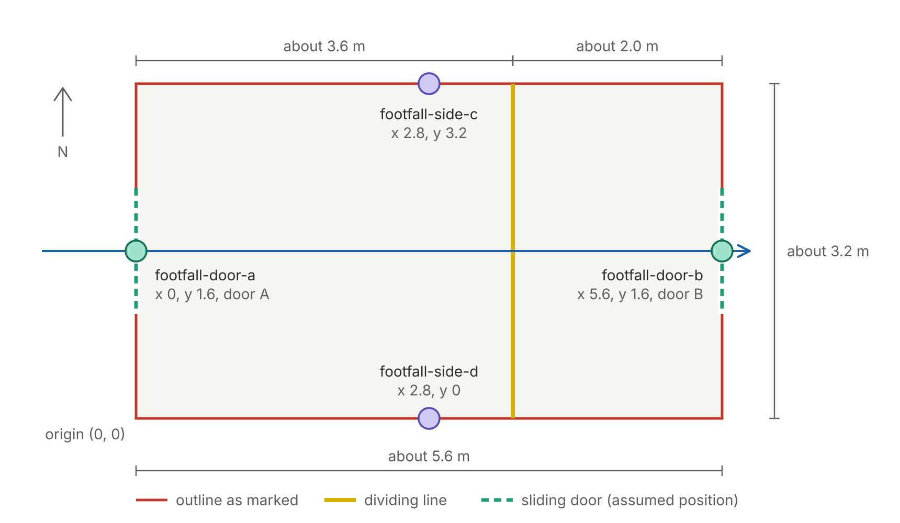
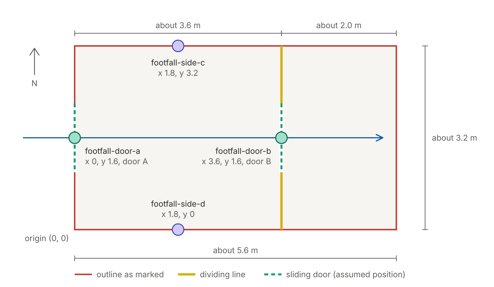

# Site layout: measurements and two candidate node layouts

Estimated dimensions of the first site, and the two ways the four nodes could be placed in it. Which one is right depends on where the two sliding doors actually are, which still has to be confirmed on site.

## Measurements

The area was marked on a north-up aerial image as a red outline with a yellow line dividing it. Two reference points were given: the north end of the dividing line and the south-east corner of the outline.

| | East to west | North to south |
|---|---|---|
| Between the two reference points | 1.95 m | 3.2 m (3.7 m diagonal) |
| West part (west edge to dividing line) | about 3.6 m | about 3.2 m |
| East part (dividing line to east edge) | about 2.0 m | about 3.2 m |
| Whole outline | about 5.6 m | about 3.2 m |

**How these were worked out.** The two reference points span the diagonal of the east part, which gives its width and height directly and a scale of about 2.3 cm per image pixel. Both axes give the same scale, which is what confirms the image is north-up and the points are those two corners. The west part and the total were then measured on the image with that scale.

**How far to trust them.** About ±0.3 m. The image is blurry at this zoom and the outline was drawn by hand. That is good enough: node positions only need to be right to within half a metre or so, because position estimates are no better than a couple of metres anyway. Measure with a tape on site if you want to tighten them.

The raw coordinates and the aerial image are deliberately not in this repository, since they pin down the location.

## Coordinates used in the configs

- Origin (0, 0) is the south-west corner of the outline.
- x runs east, y runs north, both in metres.
- The dividing line is at x = 3.6.
- Doors are assumed to be centred on the short walls, at y = 1.6.

## Variant 1: doors at the west and east ends



Config: [`examples/site-doors-at-ends.yaml`](../../examples/site-doors-at-ends.yaml)

```yaml
ble_footfall:
  nodes:
    footfall-door-a: { x: 0,   y: 1.6, door: A }   # west end
    footfall-door-b: { x: 5.6, y: 1.6, door: B }   # east end
    footfall-side-c: { x: 2.8, y: 3.2 }            # north wall
    footfall-side-d: { x: 2.8, y: 0 }              # south wall
```

## Variant 2: second door on the dividing line



Config: [`examples/site-door-on-dividing-line.yaml`](../../examples/site-door-on-dividing-line.yaml)

```yaml
ble_footfall:
  nodes:
    footfall-door-a: { x: 0,   y: 1.6, door: A }   # west end
    footfall-door-b: { x: 3.6, y: 1.6, door: B }   # on the dividing line
    footfall-side-c: { x: 1.8, y: 3.2 }            # north wall
    footfall-side-d: { x: 1.8, y: 0 }              # south wall
```

The east part of the outline is then beyond door B and outside the nodes.

## What to expect from each

| | Variant 1: doors at the ends | Variant 2: door on the dividing line |
|---|---|---|
| Distance between door nodes | 5.6 m | 3.6 m |
| Smallest distance between two nodes | 3.2 m | 2.4 m |
| `confirm_rssi` derived from the layout | -70.3 dBm | -66.9 dBm |
| Walk-throughs counted (simulated) | 100% | 100% |
| Entry and exit door both right (simulated) | 95 to 98% | 78 to 84% |
| Outside passers wrongly counted, no wall loss (simulated) | 1 to 34% | 0 to 13% |

Counting works the same in both. The difference is direction: with the door nodes only 3.6 m apart, a walker passes both within about two and a half seconds, and the nodes report every two.

**About the simulated numbers.** 1,200 people per case walking straight through the middle at 1.4 m/s, alternating direction, with 4 dB and 6 dB of random signal noise (the low and high end of each range). Outside passers walk past 1.5 m outside door A with nothing in between; any real wall or door glass lowers that figure. These check the logic and compare the two layouts. They are not a prediction of accuracy on site.

## Still to confirm

1. What the dividing line is: one of the sliding doors, or a wall between two roofs.
2. Where each sliding door is along its wall. The configs assume the middle.
3. Mounting spots for the two side nodes. Halfway between the doors is ideal, but a metre either way does not matter.

Once those are known, copy the matching example into `configuration.yaml`, adjust any position that turned out different, and restart Home Assistant.
